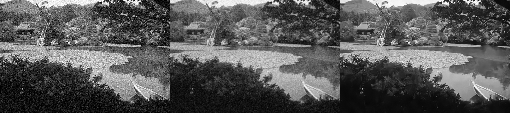
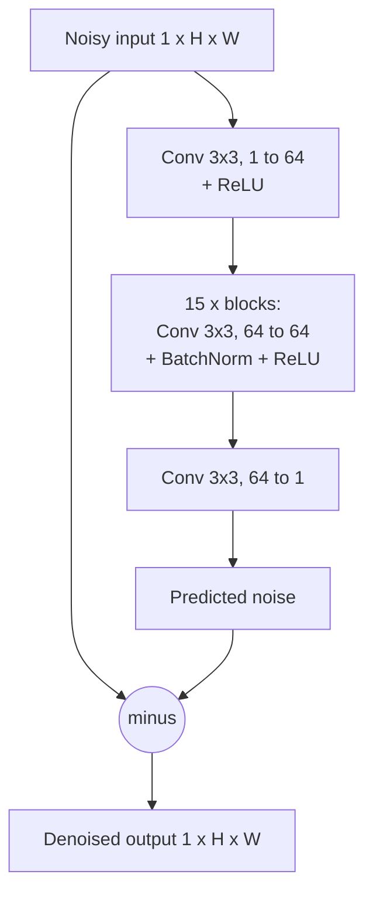

# CNN Image Denoiser

A small deep learning denoiser for grayscale images, built from scratch in PyTorch and trained on a CPU. It removes Gaussian noise (σ = 25) and is compared against the best classical baseline, a Gaussian blur.

This README walks through how the project was built, phase by phase, and ends with an honest list of limitations.

---

## Results

| Method | Validation patches (PSNR) | Single test image (PSNR) |
|---|---|---|
| Noisy input | 20.47 dB | 20.68 dB |
| Gaussian blur (best σ) | 26.24 dB (blur σ = 1.0) | 24.21 dB (blur σ = 0.75) |
| **DnCNN (this project)** | **28.53 dB** (20-epoch run) | **26.16 dB** |




Notes:

- Validation patches are 1,600 fixed noisy 64×64 patches from the BSD500 validation split.
- The Gaussian blur strength was chosen with access to the clean image (an "oracle"), so the classical baseline is stronger than it would be in real use.
- Update the validation number if you retrain with the longer cosine schedule (see Phase 4).

---

## Project structure

```
denoiser/
├── data/BSDS500/images/{train,val,test}/   # dataset, kept out of Git
├── src/
│   ├── noise.py        # noise generation
│   ├── dataset.py      # PyTorch Dataset: crop, augment, add noise
│   ├── model.py        # DnCNN
│   └── metrics.py      # PSNR
├── scripts/
│   ├── check_data.py   # visual sanity check of noisy/clean pairs
│   ├── baseline.py     # Gaussian-blur baseline on the validation set
│   ├── train.py        # training loop
│   └── compare.py      # noisy vs Gaussian vs model on any image
├── config.py           # all hyperparameters in one place
└── requirements.txt
```

Make sure `DATA_DIR` in `config.py` matches the dataset folder name on disk.

---

## Pipeline overview

```mermaid
flowchart LR
    A[BSD500 clean images] --> B[Load as grayscale, scale to 0-1]
    B --> C[Random 64x64 crop]
    C --> D[Flip / rotate<br/>train only]
    D --> E[Add Gaussian noise<br/>sigma = 25]
    E --> F[(noisy, clean) pair]
    F --> G[DnCNN]
    G --> H[Predicted noise]
    E --> I[Subtract]
    H --> I
    I --> J[Denoised image]
    J --> K[MSE loss vs clean]
    F --> K
    K --> L[Adam update]
    L --> G
```

---

## Phase 1: Dataset

The project uses **BSD500** (Berkeley Segmentation Dataset), which is already split into 200 train, 100 validation and 200 test images.

Design decisions:

- **Only clean images are needed.** Noise is generated synthetically, so every clean image yields unlimited noisy/clean pairs.
- **The split is fixed up front.** The test images are never used for tuning, which prevents data leakage.
- **Images are converted to grayscale.** One channel means a smaller model, less memory and faster CPU training.

## Phase 2: Data pipeline

### Noise model

Each noisy image `y` is the clean image `x` plus independent Gaussian noise:

$$y = x + n, \qquad n \sim \mathcal{N}(0, \sigma^2)$$

Images are stored as `float32` in [0, 1], so the 0-255 noise level is rescaled: the noise standard deviation used in code is σ / 255. The result is clipped back to [0, 1].

### Dataset class

- All images are loaded into RAM once (about 30 MB for the training split).
- Each sample is a random 64×64 crop. `PATCHES_PER_IMAGE = 16` makes one epoch 200 × 16 = 3,200 samples.
- **Training** uses an unseeded random generator, so every epoch sees new crops, flips, rotations and noise.
- **Validation** seeds the generator with `seed + index`, so the exact same 1,600 noisy patches appear every time. This makes scores comparable between runs.
- Samples are returned as `(1, 64, 64)` tensors: channel, height, width.

## Phase 3: Baseline and model

### Metric: PSNR

$$\text{PSNR} = 10 \log_{10}\!\left(\frac{1}{\text{MSE}}\right) \text{ dB}$$

The numerator is 1 because pixel values lie in [0, 1]. Every +10 dB means the squared error is 10× smaller. For reference, noise with σ = 25 gives about 20.2 dB, and about 40 dB is visually indistinguishable from the original.

### Baseline

A Gaussian blur averages neighbouring pixels. It cannot tell noise from real detail, so beyond a certain strength it removes more signal than noise. The best blur on the validation patches was σ = 1.0 (26.24 dB), and stronger blurs scored lower.

### Model: DnCNN

DnCNN uses **residual learning**: the network predicts the *noise*, and the result is subtracted from the input.

$$\hat{x} = y - \mathcal{R}(y), \qquad \mathcal{R}(y) \approx n$$

Noise is statistically simple (zero mean, independent at each pixel), while image content is complicated. Predicting the noise is an easier target than reproducing the whole image.



Architecture facts:

- 17 convolutional layers, all 3×3 with padding 1, so the output size equals the input size.
- **Parameters: 556,097.** First layer 640, each of the 15 middle layers 36,992 (36,864 conv weights + 128 BatchNorm parameters), last layer 577.
- **Receptive field: 35×35 pixels.** Each 3×3 layer adds one pixel of context on each side, so a depth of d gives 2d + 1.
- Because the network is fully convolutional (no pooling, no fully connected layers), the same weights work on any image size. Training uses 64×64 patches only for speed.

## Phase 4: Training

| Setting | Value |
|---|---|
| Loss | MSE (L2), which directly optimizes PSNR |
| Optimizer | Adam, learning rate 1e-3 |
| Batch size | 16 |
| Patch size | 64×64 |
| Noise level | σ = 25 |
| Schedule | Cosine annealing, stepped every batch, down to 1e-6 |
| Checkpointing | Best validation PSNR is saved to `best.pt` |

The cosine schedule lowers the learning rate smoothly so the weights settle:

$$\eta_t = \eta_{\min} + \tfrac{1}{2}(\eta_{\max} - \eta_{\min})\left(1 + \cos\frac{\pi t}{T}\right)$$

where `t` is the current step and `T` is the total number of steps (epochs × batches per epoch).

Training notes:

- `model.train()` and `model.eval()` matter: BatchNorm uses batch statistics while training and stored running averages while validating.
- The first run used 20 epochs and was still improving, so a longer 60-epoch run with the cosine schedule was the next experiment.
- Improvements to try, one at a time: longer training, L1 loss, a wider or deeper model.

## Phase 5: Evaluation

`scripts/compare.py` takes any image, optionally adds noise, then produces `comparison.png` with the noisy image, the Gaussian result, the model result and (when available) the clean original side by side.

When the clean image is known, the script picks the blur strength that scores best, which gives the classical method an advantage a real user would not have. The model still wins by about 2 dB on the test image.

---

## Planned: Phases 6 and 7 (not yet built)

- **Export** the trained model to ONNX, optionally quantized to int8.
- **Deploy** on Cloudflare. Options: run the model in the browser with ONNX Runtime Web (static hosting on Pages, no server cost), or run a Python + ONNX Runtime API in a Cloudflare Container. Plain Workers are too small for this model.

---

## Limitations

- **Gaussian noise only.** Real camera noise is signal-dependent and spatially correlated, so this model is expected to do worse on real photos, possibly worse than a simple blur.
- **Fixed noise level.** The model was trained at σ = 25 only (non-blind). At other levels it will under- or over-smooth. Training on a range of σ values would fix this.
- **Grayscale only.** Colour images would need a 3-channel version or per-channel processing.
- **Small training set.** 200 training images is tiny by modern standards.
- **The "clean" images are not perfectly clean.** BSD500 images are JPEG-compressed, so they already contain compression artifacts that the model treats as ground truth.
- **Small model, short training.** About 556k parameters trained for a limited number of epochs on a CPU. State-of-the-art denoisers are far larger.
- **Clipping distorts the noise.** Clipping to [0, 1] slightly changes the noise statistics near pure black and white.
- **Border effects.** Zero padding means pixels near the image edge see fake context.
- **PSNR is not perception.** A higher PSNR can still look over-smoothed. Judge visually as well, and consider SSIM or perceptual metrics.
- **Memory grows with image size.** Each layer stores 64 feature maps at full image size, so large photos need to be processed in tiles.
- **Limited statistical evidence.** Results come from single training runs and one test image for the comparison, so small differences should not be over-interpreted.
- **Oracle baseline.** The Gaussian blur strength is tuned with the clean image, which makes the baseline stronger than real-world use.

---

## Setup

```bash
pip install torch pillow numpy scipy
python -m scripts.check_data     # visual check, writes check.png
python -m scripts.baseline       # classical baseline on validation set
python -m scripts.train          # trains, saves best.pt
python -m scripts.compare path/to/image.jpg --add-noise
```